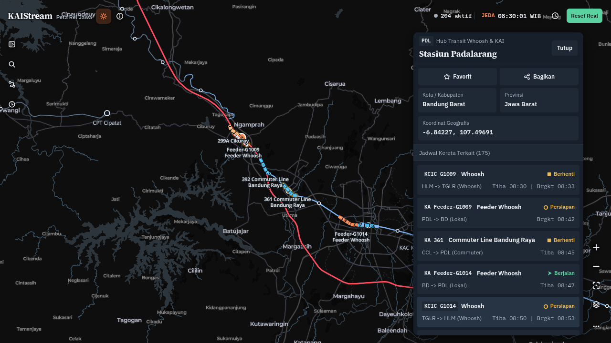

<p align="left">
  
</p>

# KAIStream

Peta atlas interaktif dan simulasi deterministik pergerakan kereta api di Pulau Jawa untuk jaringan PT Kereta Api Indonesia (`1067 mm`) serta Kereta Cepat Whoosh PT KCIC (`1435 mm`) berbasis Grafik Perjalanan Kereta Api (GAPEKA) di zona waktu WIB (`UTC+7`).

> [!NOTE]
> Posisi kereta di KAIStream dihitung melalui interpolasi jadwal referensi GAPEKA terhadap geometri rel OpenStreetMap, bukan telemetri GPS waktu nyata. Proyek ini bersifat independen dan tidak berafiliasi dengan PT Kereta Api Indonesia (Persero), PT KAI Commuter, maupun PT Kereta Cepat Indonesia China (KCIC).


## Cakupan Dataset Terverifikasi

Data statis pada [`public/data/`](public/data/) dibangun dari ekstraksi jaringan rel OpenStreetMap Pulau Jawa serta jadwal resmi GAPEKA Kemenhub DJKA (`KP-DJKA 116 Tahun 2026`, `KP-DJKA 224 Tahun 2024`, dan `KP-DJKA 2 Tahun 2025`):

| Metrik Dataset | Nilai Terverifikasi | Keterangan |
| :--- | ---: | :--- |
| Provinsi tercakup | `6` | Banten, DKI Jakarta, Jawa Barat, Jawa Tengah, DI Yogyakarta, Jawa Timur |
| Total perjalanan harian | `2.490` | Antarkota, Commuter Line, Kereta Cepat Whoosh, Lokal, dan Bandara |
| Perjalanan Kereta Cepat Whoosh | `62` | `G1003` s.d. `G1064` relasi Halim, Karawang, Padalarang, Tegalluar Summarecon |
| Titik waktu lintas langsung (`Ls`) | `13.215` | Checkpoint waktu stasiun non-berhenti untuk akurasi kecepatan per petak |
| Stasiun terpetakan | `461` | Termasuk `111` stasiun utama dan hub transit antarmoda Padalarang (`PDL`) |
| Segmen rel operasional | `11.317` | Dari `12.244` total segmen rel Pulau Jawa (`1.636` tunggal, `5.014` ganda, `1.004` tiga jalur, `3.663` empat jalur/DDT) |
| Segmen rel cepat `1435 mm` | `316` | Jalur ganda terisolasi Halim s.d. Tegalluar (`130` segmen jembatan layang, `26` terowongan) |
| Geometri koridor unik | `368` | Polilin rute tervalidasi dengan jarak kumulatif per titik |
| Galat validasi jadwal & geometri | `0` | Diuji otomatis pada waktu build dan melalui rangkaian tes Vitest |

## Galeri Tampilan

| Koridor Kereta Cepat Whoosh (`1435 mm`) | Mode Peta Malam & Hub Transit Padalarang (`PDL`) |
| :---: | :---: |
|  |  |
| Pemisahan jalur ganda `1435 mm` berwarna merah dari jalur KAI `1067 mm`, lengkap dengan detail kecepatan `KCIC G1012` (`293 km/j`) dan status lintas langsung (`Ls`) Karawang. | Tampilan malam di sekitar Padalarang dan Bandung yang memperlihatkan keterhubungan jadwal Whoosh dengan KA Feeder Whoosh serta Commuter Line Bandung Raya. |

<p align="center">
  
</p>

## Kemampuan Utama

1. Mesin simulasi deterministik menghitung posisi, haluan (`bearing`), persentase progres, dan estimasi kecepatan setiap kereta pada 60 FPS menggunakan interpolasi polilin per petak (`piecewise`), kurva percepatan/pengereman stasiun, serta `13.215` titik lintas langsung (`Ls`).
2. Graf jaringan rel memisahkan secara fisik dan visual jaringan KAI `1067 mm` (mengikuti aturan sepur kanan sesuai UU 23/2007 serta pemisahan 4 jalur KRL dan KAJJ pada koridor Double-Double Track Manggarai s.d. Bekasi) dari jaringan ganda `1435 mm` Kereta Cepat Whoosh (`G_whoosh_eb` lajur selatan arah Tegalluar dan `G_whoosh_wb` lajur utara arah Halim).
3. Rangkaian kereta dirender sebagai 4 unit terartikulasi (1 lokomotif/kabin depan dan 3 kereta di belakangnya tanpa ekor garis) yang menekuk mengikuti kelengkungan rel secara geometris, dengan desain khusus CR400AF putih-merah untuk Whoosh.
4. Kontrol Time Machine memungkinkan pemutaran waktu simulasi pada kecepatan `1x`, `5x`, `10x`, `20x`, `60x`, hingga `120x`, lompatan jam cepat, penggeseran manual sepanjang 24 jam WIB, serta penyaringan pola operasional (`Semua Jadwal`, `Hari Kerja`, `Akhir Pekan`).
5. Pencari rute mendukung perjalanan langsung maupun transit 1 kali pindah kereta di seluruh Pulau Jawa, termasuk transit terpadu `Halim (HLM) -> Bandung (BD)` melalui `Padalarang (PDL)` yang menggabungkan Kereta Cepat Whoosh dengan KA Feeder Whoosh.
6. Tiga pilihan peta dasar (`Standar` bergaya kertas kartografi, `Satelit` Esri World Imagery, dan `Topografi` Esri World Topo) dilengkapi opsi overlay radar curah hujan langsung dari RainViewer API.
7. Permalink URL menyinkronkan koordinat kamera (`#map=zoom/lat/lon`), kereta terpilih (`?train=`), stasiun terpilih (`?station=`), gaya peta dasar (`?bm=`), dan status radar hujan (`?rain=1`) sehingga tautan dapat langsung dibagikan.

## Menjalankan Secara Lokal

### Prasyarat

- Node.js `22+` dan `npm`
- Python `3.11+` beserta paket `networkx`, `beautifulsoup4`, dan `poppler-utils` (`pdftotext`) apabila ingin membangun ulang dataset dari sumber hulu

### Instalasi dan Server Pengembangan

```bash
npm install
npm run dev
```

Buka alamat yang ditampilkan oleh Vite (umumnya `http://localhost:5173`) di peramban.

### Pengujian dan Build Produksi

```bash
# Menjalankan 13 pengujian unit, geometri, mesin simulasi, dan integrasi dataset
npm test

# Memeriksa tipe TypeScript dan membangun bundel produksi ke direktori dist/
npm run build

# Menjalankan server pratinjau produksi
npm run preview
```

### Membangun Ulang atau Menyinkronkan Dataset

Repositori ini sudah menyertakan snapshot dataset tervalidasi di [`public/data/`](public/data/) sehingga aplikasi langsung berjalan tanpa perlu menjalankan skrip Python terlebih dahulu. Untuk memperbarui data jadwal dan jaringan rel secara manual:

```bash
# Membangun ulang dataset menggunakan cache lokal bila tersedia
npm run build:data

# Memaksa pembaruan jadwal dari sumber hulu dan menyalin hasil ke dist/data
npm run sync:refresh

# Menjalankan skrip sinkronisasi harian berpenjaga flock (untuk cron lokal)
npm run sync:data
```

## Struktur Repositori

```text
kaistream/
├── .github/workflows/
│   ├── ci.yml                # Pipeline verifikasi tes & build pada push/PR
│   └── sync-data.yml         # Jadwal GitHub Actions harian (00:05 WIB) pembaruan data
├── docs/
│   ├── ARCHITECTURE.md       # Arsitektur front-end, state, dan layer MapLibre WebGL
│   ├── DATA_PIPELINE.md      # Pipeline ekstraksi data Python, graf 1067mm/1435mm, dan failover
│   ├── SIMULATION.md         # Matematika interpolasi, titik Ls, dan artikulasi 4 kereta
│   └── images/               # Tangkapan layar aplikasi untuk dokumentasi
├── public/
│   ├── data/                 # Dataset JSON statis (stations, routes, timetable, rail-network)
│   ├── favicon.svg           # Ikon vektor utama KAIStream
│   ├── favicon.ico           # Favicon multi-resolusi (16x16, 32x32, 48x48)
│   └── site.webmanifest      # Manifes aplikasi web
├── scripts/
│   ├── build_java_data.py    # Pembangun graf rel OSM, rute terarah, dan jadwal Jawa
│   ├── djka_source.py        # Ekstraktor resmi GAPEKA Kemenhub DJKA (KAJJ & Whoosh PDF)
│   └── auto_sync.sh          # Pembungkus sinkronisasi otomatis dengan penguncian flock
├── src/
│   ├── components/           # Komponen UI React dan kanvas peta MapLibre GL
│   ├── engine/               # Mesin simulasi murni, geometri, validator, dan pencari rute
│   ├── styles/               # Token warna kartografi, reset dasar, dan tata letak responsif
│   ├── utils/                # Warna livery, label, penyimpanan favorit, dan state URL
│   ├── App.tsx               # Orkestrasi state aplikasi dan sinkronisasi waktu WIB
│   └── main.tsx              # Titik masuk React
├── DESIGN.md                 # Spesifikasi palet kartografi, tipografi, dan kontras WCAG AA
├── CONTRIBUTING.md           # Panduan kontribusi dan standar verifikasi
└── LICENSE                   # Lisensi MIT
```

## Dokumentasi Teknis Lebih Lanjut

- [Arsitektur Aplikasi dan Layer Peta (`docs/ARCHITECTURE.md`)](docs/ARCHITECTURE.md)
- [Pipeline Data, Isolasi Graf 1067 mm vs 1435 mm, dan Failover (`docs/DATA_PIPELINE.md`)](docs/DATA_PIPELINE.md)
- [Mesin Simulasi, Interpolasi Titik `Ls`, dan Artikulasi Kereta (`docs/SIMULATION.md`)](docs/SIMULATION.md)
- [Sistem Desain dan Palet Kartografi (`DESIGN.md`)](DESIGN.md)
- [Panduan Kontribusi (`CONTRIBUTING.md`)](CONTRIBUTING.md)

## Sumber Data dan Atribusi

1. Geometri jaringan rel dan stasiun Pulau Jawa berasal dari kontributor [OpenStreetMap](https://www.openstreetmap.org/copyright) melalui ekstrak Geofabrik Pulau Jawa di bawah lisensi ODbL 1.0.
2. Regulasi dan jadwal referensi resmi GAPEKA bersumber dari Direktorat Jenderal Perkeretaapian, Kementerian Perhubungan RI ([djka.kemenhub.go.id/regulasi](https://djka.kemenhub.go.id/regulasi)): `KP-DJKA 116 Tahun 2026` (GAPEKA Jawa 2026), `KP-DJKA 224 Tahun 2024` (GAPEKA Jawa 2025), serta `KP-DJKA 2 Tahun 2025` (GAPEKA Kereta Api Kecepatan Tinggi Jakarta-Bandung Whoosh).
3. Data jadwal operasional harian dan titik lintas stasiun diperkaya melalui AluRail Public Data, Comuline API, [Sobat KRL Master Data](https://github.com/kangfarih/sobat-krl-master-data) (ODbL 1.0), dan referensi koordinat stasiun dari [TrackingKRL](https://github.com/oktavianrizalm/TrackingKRL).
4. Poligon batas provinsi dan garis pantai bersumber dari BAKOSURTANAL (`superpikar/indonesia-geojson`) serta Natural Earth 10m Land Coastlines (Domain Publik).
5. Peta dasar disediakan oleh CARTO Basemaps, Esri World Imagery, dan Esri World Topo Map. Citra radar cuaca opsional disediakan oleh RainViewer Public Weather Radar API.

## Lisensi

Kode sumber perangkat lunak KAIStream dilisensikan di bawah [Lisensi MIT](LICENSE). Data geospasial dan jadwal perjalanan tetap berada di bawah ketentuan lisensi masing-masing penyedia data asal (termasuk ODbL 1.0 untuk data turunan OpenStreetMap dan Sobat KRL).
