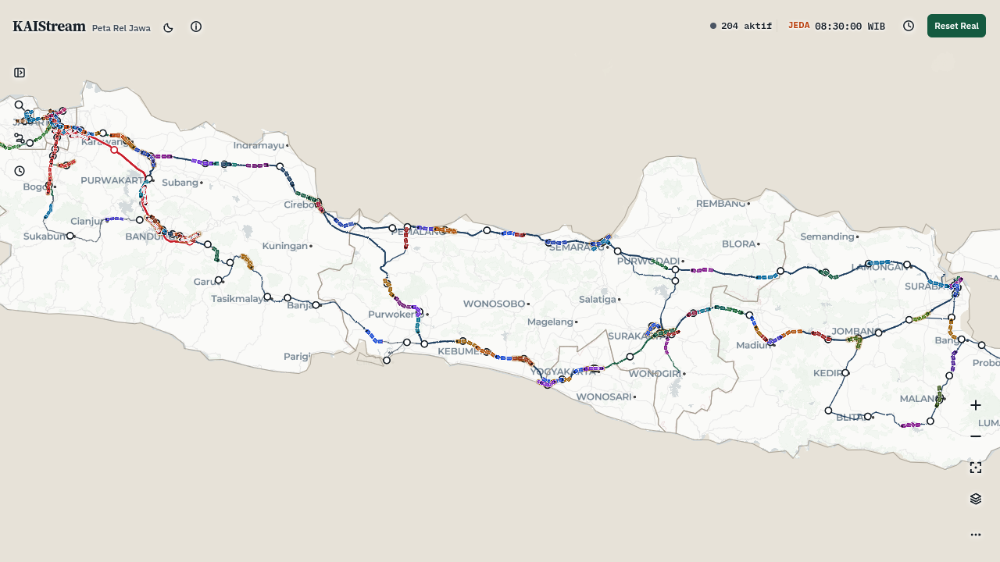
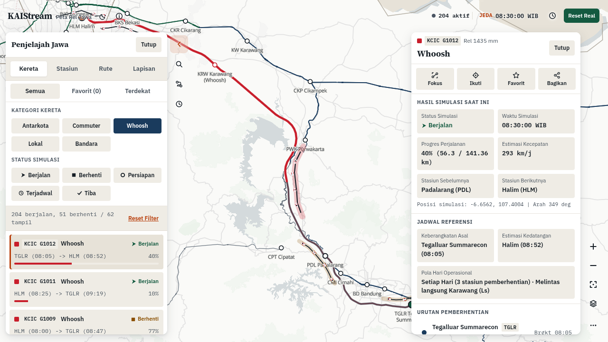
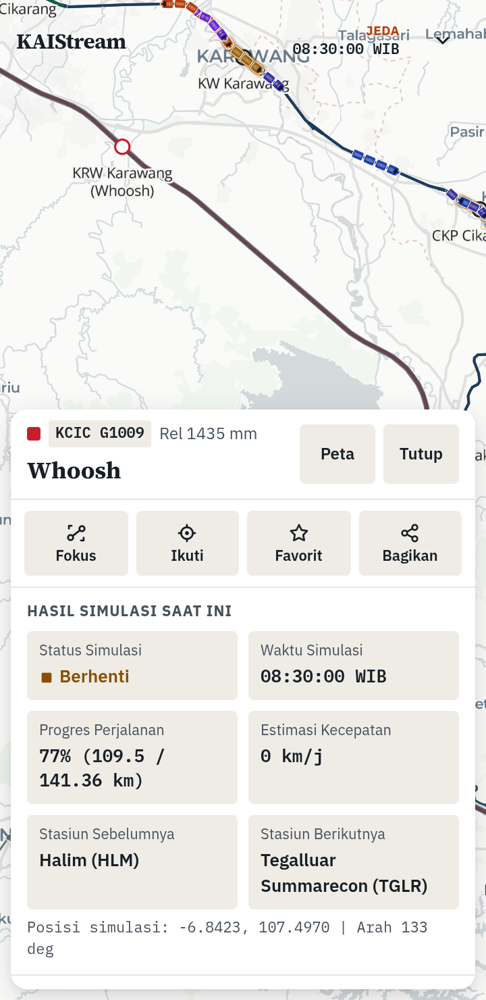

<p align="center">
  
</p>

<h1 align="center">KAIStream</h1>

<p align="center">
  <strong>Peta atlas interaktif dan simulasi deterministik pergerakan kereta api di Pulau Jawa</strong>
</p>

<p align="center">
  Memvisualisasikan jaringan rel ganda PT KAI (1067 mm) dan Kereta Cepat Whoosh PT KCIC (1435 mm) secara bersamaan berbasis jadwal resmi GAPEKA pada zona waktu WIB (UTC+7).
</p>

<p align="center">
  <a href="https://github.com/kaivyy/KAIStream/actions/workflows/ci.yml"></a>
  <a href="LICENSE"></a>
  <a href="https://www.typescriptlang.org/"></a>
  <a href="https://react.dev/"></a>
  <a href="https://vitejs.dev/"></a>
  <a href="https://maplibre.org/"></a>
  <a href="https://vitest.dev/"></a>
</p>

---

<p align="center">
  
</p>

---

## Keterangan Proyek

KAIStream adalah aplikasi web berbasis peta vektor interaktif (MapLibre GL JS) yang menampilkan pergerakan kereta api di seluruh Pulau Jawa secara deterministik. Posisi setiap rangkaian dihitung secara matematis pada 60 frame per detik menggunakan model kinematika berbasis jadwal referensi Grafik Perjalanan Kereta Api (GAPEKA) dan geometri rel presisi dari OpenStreetMap.

Sistem ini menggabungkan dua ekosistem perkeretaapian yang beroperasi di Pulau Jawa:
1. **Jaringan Nasional PT KAI (Gauge 1067 mm):** Mencakup Kereta Api Antarkota (Eksekutif, Bisnis, Ekonomi), KRL Commuter Line (Jabodetabek, Yogyakarta-Solo, Bandung Raya), KA Bandara, dan KA Lokal di 6 provinsi.
2. **Jaringan Kereta Cepat Whoosh PT KCIC (Gauge Standar 1435 mm):** Koridor kecepatan tinggi Halim s.d. Tegalluar Summarecon dengan batas kecepatan operasional hingga 350 km/jam, dipisahkan secara geometri pada jalur ganda terisolasi (lajur selatan ke arah timur dan lajur utara ke arah barat).

> [!NOTE]
> KAIStream mengandalkan perhitungan deterministik terhadap jadwal GAPEKA dan titik lintas langsung (Ls), bukan data telemetri GPS waktu nyata dari lokomotif. Proyek ini dikembangkan secara independen dan tidak memiliki afiliasi resmi dengan PT Kereta Api Indonesia (Persero), PT Kereta Commuter Indonesia, maupun PT Kereta Cepat Indonesia China (KCIC).

### Cakupan Dataset Terverifikasi

Snapshot data statis pada direktori [`public/data/`](public/data/) telah tervalidasi penuh tanpa galat:

| Komponen Data | Jumlah Terverifikasi | Sumber dan Spesifikasi |
| :--- | ---: | :--- |
| Provinsi aktif | `6` | Banten, DKI Jakarta, Jawa Barat, Jawa Tengah, DI Yogyakarta, Jawa Timur |
| Total jadwal perjalanan harian | `2.490` | GAPEKA Kemenhub DJKA (KP-DJKA 116/2026 dan KP-DJKA 224/2024) |
| Perjalanan Kereta Cepat Whoosh | `62` | KP-DJKA 2/2025 (G1003 s.d. G1064 Halim-Tegalluar pp) |
| Titik waktu lintas langsung (`Ls`) | `13.215` | Checkpoint stasiun non-berhenti untuk interpolasi kecepatan per petak |
| Stasiun dan perhentian | `461` | 111 stasiun KAJJ utama, stasiun KRL commuter, dan 4 stasiun Whoosh |
| Segmen rel aktif | `11.317` | Dari 12.244 segmen rel OSM Jawa (1.636 tunggal, 5.014 ganda, 4.667 multi-jalur/DDT) |
| Segmen rel cepat `1435 mm` | `316` | Koridor ganda Halim-Tegalluar (130 jembatan layang, 26 terowongan) |
| Koridor rute unik | `368` | Polilin terarah dengan koordinat dan jarak kumulatif per simpul |
| Galat validasi jadwal & rel | `0` | Diverifikasi melalui skrip validasi build dan 13 uji otomatis Vitest |

### Fitur Utama

- **Interpolasi Kinematika 60 FPS:** Posisi, arah hadap (bearing), estimasi kecepatan seketika, dan persentase perjalanan dihitung mulus dengan kurva percepatan dan perlambatan di dekat stasiun.
- **Pemisahan Fisik Jalur 1067 mm dan 1435 mm:** Jalur Kereta Cepat Whoosh digambar di atas koridor layang independen berwarna merah terang, terpisah dari jalur konvensional KAI. Di koridor Manggarai s.d. Bekasi, sistem menerapkan pemisahan 4 jalur (Double-Double Track) antara jalur KRL dan KAJJ.
- **Visualisasi Artikulasi Rangkaian:** Setiap kereta ditampilkan sebagai rangkaian terartikulasi yang terdiri dari 1 unit lokomotif dan 3 kereta penumpang yang menekuk secara natural mengikuti kurva rel, tanpa artefak garis kaku. Rangkaian Whoosh menggunakan skema livery putih-merah khusus seri CR400AF.
- **Kontrol Waktu (Time Machine):** Pengguna dapat mengubah kecepatan simulasi (1x, 5x, 10x, 20x, 60x, 120x), melompat ke jam tertentu, menggeser slider waktu 24 jam WIB, atau memfilter jadwal hari kerja versus akhir pekan.
- **Pencarian Rute Antarmoda:** Mendukung pencarian perjalanan langsung dan transit 1 kali di seluruh stasiun Jawa, termasuk integrasi transfer Whoosh di Stasiun Padalarang menuju KA Feeder ke Stasiun Bandung.
- **Peta Dasar dan Overlay Cuaca:** Menyediakan pilihan tampilan Standar (gaya kertas kartografi), Satelit (Esri World Imagery), dan Topografi (Esri World Topo), ditambah overlay citra radar hujan langsung dari RainViewer.
- **Sinkronisasi State URL:** Koordinat zoom, posisi kamera, kereta yang dipilih, stasiun yang dibuka, pilihan peta dasar, dan radar hujan tersimpan pada URL permalink untuk memudahkan pembagian tautan.

### Galeri Tangkapan Layar

| Koridor Kereta Cepat Whoosh (1435 mm) | Mode Gelap & Hub Padalarang |
| :---: | :---: |
|  |  |
| Tampilan jalur ganda Whoosh 1435 mm warna merah, panel KA KCIC G1012 kecepatan 293 km/jam, dan titik Ls Karawang. | Visualisasi malam hari di sekitar Padalarang dan Bandung, memperlihatkan integrasi Whoosh, KA Feeder, dan KA Lokal. |

<p align="center">
  
  <br />
  <em>Tata letak responsif pada perangkat seluler dengan lembar geser detail kereta dan kontrol ringkas.</em>
</p>

---

## Panduan Instalasi dan Menjalankan

### Prasyarat Sistem

Sebelum memulai, pastikan perangkat Anda telah terpasang:
- **Node.js** versi 22.0.0 atau lebih baru
- **npm** versi 10.0.0 atau lebih baru
- **Git** untuk kloning repositori

*(Opsional: Python 3.11+ dan Poppler Utils hanya dibutuhkan apabila Anda hendak mengekstrak ulang jadwal dari PDF GAPEKA DJKA Kemenhub).*

### 1. Kloning Repositori

```bash
git clone https://github.com/kaivyy/KAIStream.git
cd KAIStream
```

### 2. Pemasangan Dependensi

Pasang seluruh paket pustaka yang tercantum pada `package.json`:

```bash
npm install
```

### 3. Menjalankan Server Pengembangan

Jalankan server pengembangan lokal berbasis Vite:

```bash
npm run dev
```

Buka URL lokal yang muncul di terminal (biasanya `http://localhost:5173`) menggunakan peramban modern (Chrome, Firefox, Safari, Edge).

### 4. Menjalankan Pengujian Otomatis

Jalankan pengujian unit, interpolasi matematika, mesin jadwal, dan integritas dataset menggunakan Vitest:

```bash
npm test
```

Perintah di atas akan mengeksekusi 13 modul uji tervalidasi mencakup:
- Format waktu WIB dan penanganan pergantian tengah malam (overnight cross-midnight).
- Interpolasi geometri kelengkungan rel tanpa jalan pintas lurus.
- Kinematika percepatan, perlambatan, dan offset lateral sepur kanan.
- Artikulasi 4 unit kereta pada lengkung busur lintasan.
- Validasi 2.490 perjalanan dan 461 stasiun di dalam batas geografis Pulau Jawa.

### 5. Membangun Bundel Produksi

Untuk menghasilkan berkas statis siap rilis ke direktori `dist/`:

```bash
npm run build
```

Untuk menguji hasil build produksi secara lokal:

```bash
npm run preview
```

Server pratinjau akan menyajikan aplikasi produksi pada `http://localhost:4173` atau port yang dikonfigurasikan.

### 6. Deployment ke Vercel

Aplikasi KAIStream dirancang sebagai Single Page Application (SPA) berbasis statis yang sepenuhnya siap di-deploy ke Vercel tanpa perlu konfigurasi server tambahan:

<p align="left">
  <a href="https://vercel.com/new/clone?repository-url=https%3A%2F%2Fgithub.com%2Fkaivyy%2FKAIStream"></a>
</p>

**Langkah deployment melalui dashboard Vercel:**
1. Masuk ke [vercel.com](https://vercel.com) menggunakan akun GitHub Anda.
2. Klik **Add New...** lalu pilih **Project**.
3. Pilih repositori **`kaivyy/KAIStream`** dari daftar repositori publik Anda dan klik **Import**.
4. Vercel secara otomatis membaca setelan dari `vercel.json`:
   - Framework Preset: `Vite`
   - Build Command: `npm run build`
   - Output Directory: `dist`
5. Klik **Deploy**. Aplikasi akan aktif dengan domain instan (misalnya `kaistream.vercel.app`) dan CDN Edge Network untuk pengiriman dataset cepat.

### 7. Pembaruan Dataset (Opsional)

Repositori ini sudah menyertakan snapshot dataset lengkap di direktori `public/data/` sehingga aplikasi dapat langsung dijalankan tanpa langkah build data tambahan.

Jika ingin memperbarui atau membangun ulang berkas data JSON:

```bash
# Membangun ulang dataset dari cache dan mengekspor ke public/data
npm run build:data

# Mengunduh pembaruan jadwal terbaru dari sumber resmi dan menyalin ke dist/data
npm run sync:refresh

# Menjalankan sinkronisasi dengan penguncian berkas flock (untuk tugas cron berkala)
npm run sync:data
```

---

## Struktur Direktori

```text
KAIStream/
├── .github/workflows/
│   ├── ci.yml                # Pipeline otomatis verifikasi pengujian dan build
│   └── sync-data.yml         # Workflow terjadwal harian pembaruan data GAPEKA
├── docs/
│   ├── ARCHITECTURE.md       # Dokumentasi arsitektur modul dan layer MapLibre GL
│   ├── DATA_PIPELINE.md      # Alur pemrosesan data, graf rel, dan sistem failover
│   ├── SIMULATION.md         # Matematika interpolasi polilin, kurva, dan titik Ls
│   └── images/               # Tangkapan layar antarmuka untuk dokumentasi
├── public/
│   ├── data/                 # Dataset statis JSON (stations, routes, timetable, rail-network)
│   ├── favicon.svg           # Ikon SVG utama
│   ├── favicon.ico           # Ikon multi-ukuran
│   ├── og-preview.png        # Gambar pratinjau Open Graph 1200x630
│   └── site.webmanifest      # Manifes Web App
├── scripts/
│   ├── build_java_data.py    # Pembuat graf rel OSM dan penggabung jadwal GAPEKA
│   ├── djka_source.py        # Pengunduh dan parser PDF resmi GAPEKA DJKA
│   └── auto_sync.sh          # Skrip pembungkus sinkronisasi harian dengan flock
├── src/
│   ├── components/           # Komponen antarmuka React dan kanvas peta MapLibre
│   ├── engine/               # Mesin kalkulasi deterministik, pencari rute, dan validator
│   ├── styles/               # Desain token warna kartografi dan tata letak responsif
│   ├── utils/                # Utilitas livery kereta, label stasiun, dan parser URL
│   ├── App.tsx               # Komponen utama dan siklus hidup waktu simulasi
│   └── main.tsx              # Titik masuk eksekusi React DOM
├── CONTRIBUTING.md           # Standar pengujian dan pedoman pengiriman kontribusi
├── DESIGN.md                 # Spesifikasi palet warna, tipografi, dan kontras WCAG
├── LICENSE                   # Lisensi sumber terbuka MIT
├── package.json              # Konfigurasi dependensi dan skrip proyek
├── tsconfig.json             # Konfigurasi kompilator TypeScript
├── vercel.json               # Konfigurasi routing SPA dan cache header CDN Vercel
├── vite.config.ts            # Konfigurasi bundler Vite
└── vitest.config.ts          # Konfigurasi lingkungan uji Vitest
```

---

## Dokumentasi Teknis

Rincian implementasi teknis lebih dalam dapat dipelajari pada dokumen berikut:
- [Arsitektur Aplikasi dan Render Peta](docs/ARCHITECTURE.md)
- [Pipeline Ekstraksi Data dan Integrasi Jalur](docs/DATA_PIPELINE.md)
- [Mesin Simulasi, Kinematika, dan Titik Lintas Langsung](docs/SIMULATION.md)
- [Standar Desain Kartografi dan Tata Warna](DESIGN.md)
- [Panduan Berkontribusi](CONTRIBUTING.md)

---

## Sumber Data dan Atribusi

1. **OpenStreetMap:** Geometri lintasan rel kereta dan posisi stasiun di Pulau Jawa bersumber dari kontributor [OpenStreetMap](https://www.openstreetmap.org/copyright) melalui Geofabrik di bawah lisensi ODbL 1.0.
2. **Kementerian Perhubungan RI (DJKA):** Jadwal perjalanan dan aturan operasional merujuk pada regulasi resmi Direktorat Jenderal Perkeretaapian ([djka.kemenhub.go.id/regulasi](https://djka.kemenhub.go.id/regulasi)): Keputusan Menhub Nomor `KP-DJKA 116 Tahun 2026`, `KP-DJKA 224 Tahun 2024`, dan `KP-DJKA 2 Tahun 2025`.
3. **Data Jadwal Pelengkap:** Jadwal KRL Commuter Line dan kereta lokal diperkaya melalui sumber terbuka [Sobat KRL Master Data](https://github.com/kangfarih/sobat-krl-master-data) (ODbL 1.0), AluRail Public Data, Comuline API, serta referensi titik henti stasiun dari [TrackingKRL](https://github.com/oktavianrizalm/TrackingKRL).
4. **Batas Geografis:** Data poligon garis pantai dan wilayah provinsi Jawa mengacu pada data BAKOSURTANAL (`superpikar/indonesia-geojson`) serta Natural Earth 10m Land Coastlines.
5. **Peta Dasar & Cuaca:** Ubin peta disediakan oleh CARTO Basemaps, Esri World Imagery, dan Esri World Topo. Citra radar cuaca disediakan oleh RainViewer Public Weather Radar API.

---

## Lisensi

Seluruh kode sumber perangkat lunak KAIStream didistribusikan di bawah ketentuan [Lisensi MIT](LICENSE).

Data geospasial jaringan rel dan jadwal operasional tunduk pada ketentuan lisensi penyedia masing-masing, termasuk Open Database License (ODbL 1.0) untuk data turunan OpenStreetMap dan Sobat KRL.
