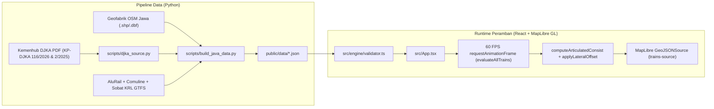

# Arsitektur Aplikasi KAIStream

KAIStream dirancang sebagai aplikasi web satu halaman (`Single-Page Application`) yang menyajikan dataset jadwal dan jaringan rel Pulau Jawa dari berkas JSON statis di [`public/data/`](../public/data/) tanpa membutuhkan basis data runtime atau server backend khusus. Seluruh evaluasi posisi kereta, pencarian rute transit, dan rendering ribuan segmen rel berjalan langsung di peramban menggunakan TypeScript dan WebGL (MapLibre GL JS).

## Tumpukan Teknologi

| Lapisan | Teknologi | Peran |
| :--- | :--- | :--- |
| Antarmuka & State | React `19.0` + TypeScript `5.7` | Pengelolaan state panel, jam simulasi WIB, filter, dan aksesibilitas keyboard |
| Peta & Rendering GPU | MapLibre GL JS `5.1` | Rendering polilin rel multi-lajur, stasiun, radar cuaca, dan 60 FPS sprite kereta |
| Bundler & Dev Server | Vite `6.1` | Kompilasi modul ES2022 dan penyajian aset statis |
| Pengujian | Vitest `3.0` | Pengujian unit geometri, mesin simulasi, validator dataset, dan pencari rute |
| Pipeline Data Offline | Python `3.11+` (`networkx`, `beautifulsoup4`, `poppler-utils`) | Konstruksi graf jaringan rel terarah dan ekstraksi jadwal GAPEKA |

## Diagram Alir Data dan Rendering

## Pembagian Modul Kode Sumber

### 1. Mesin Murni (`src/engine/`)

Seluruh modul di dalam `src/engine/` bebas dari ketergantungan DOM atau React sehingga dapat diuji secara deterministik di Node.js melalui Vitest:

- [`src/engine/types.ts`](../src/engine/types.ts) mendefinisikan tipe domain utama (`TrainCategory`, `TrainStatus`, `RailLayerKey`, `Station`, `RouteShape`, `TrainStop`, `TrainTrip`, `SimulatedTrain`, dan `DatasetMetadata`).
- [`src/engine/time.ts`](../src/engine/time.ts) menangani konversi waktu WIB (`UTC+7`), pembacaan jam perangkat di zona `Asia/Jakarta`, serta perhitungan selisih waktu melintasi tengah malam (`SECONDS_PER_DAY = 86400`).
- [`src/engine/geometry.ts`](../src/engine/geometry.ts) menyediakan fungsi interpolasi polilin berdasarkan jarak kumulatif, kurva percepatan/pengereman (`applyKinematicEasing`), perhitungan posisi 4 unit kereta terartikulasi (`computeArticulatedConsist`), pergeseran lateral tegak lurus arah hadap (`applyLateralOffset`), serta pemotongan rute menjadi bagian yang sudah ditempuh dan sisa rute (`splitPolylineAtDistance`).
- [`src/engine/simulation.ts`](../src/engine/simulation.ts) mengevaluasi posisi dan status seluruh kereta (`evaluateAllTrains` dan `evaluateTrainAtTime`) pada detik simulasi tertentu, termasuk kereta malam dari hari sebelumnya (`activeDayShift = 86400`).
- [`src/engine/validator.ts`](../src/engine/validator.ts) memeriksa batas geografis Pulau Jawa (`lon 104.90..114.75`, `lat -8.98..-5.68`), ketersediaan stasiun dan geometri rute, serta kemonotonan waktu dan jarak pada setiap perjalanan.
- [`src/engine/routeSearch.ts`](../src/engine/routeSearch.ts) mencari jadwal perjalanan langsung maupun kombinasi transit 1 kali pindah kereta antarstasiun dengan batasan waktu tunggu (`minLayoverMin` s.d. `maxLayoverMin`).
- [`src/engine/nearby.ts`](../src/engine/nearby.ts) menghitung jarak Haversine dan mata angin dari titik tengah peta atau koordinat GPS pengguna ke kereta aktif terdekat.

### 2. Komponen Antarmuka dan Peta (`src/components/`)

- [`src/components/JavaRailMap.tsx`](../src/components/JavaRailMap.tsx) mengelola instans MapLibre GL, batas geser peta (`JAVA_PAN_BOUNDS`), pergantian gaya peta dasar (`Standar`, `Satelit`, `Topografi`) beserta fallback offline otomatis bila ubin eksternal gagal dimuat, layer radar hujan RainViewer, pembuatan sprite kanvas 4 kereta (`makeTrainCarSprite`), dan loop animasi 60 FPS yang langsung memperbarui sumber GeoJSON tanpa memicu render ulang pohon komponen React.
- [`src/components/HeaderBar.tsx`](../src/components/HeaderBar.tsx) merender HUD sudut kiri atas (wordmark `KAIStream`, tombol tema, tombol info sumber data), HUD jam simulasi WIB di sudut kanan atas, serta modal pencarian cepat (`/`) untuk kereta dan stasiun.
- [`src/components/ExplorerPanel.tsx`](../src/components/ExplorerPanel.tsx) menampilkan laci navigasi kiri dengan empat tab (`Kereta`, `Stasiun`, `Rute`, `Lapisan`) beserta tombol pintas mengambang di tepi peta.
- [`src/components/TrainDetailPanel.tsx`](../src/components/TrainDetailPanel.tsx) dan [`src/components/StationDetailPanel.tsx`](../src/components/StationDetailPanel.tsx) menampilkan panel detail di sisi kanan (atau bottom sheet di layar mobile) berisi tombol aksi proporsional (`Fokus`, `Ikuti`, `Favorit`, `Bagikan`), telemetri simulasi, dan daftar urutan stasiun.
- [`src/components/RouteSearchView.tsx`](../src/components/RouteSearchView.tsx) dan [`src/components/NearbyTrainsView.tsx`](../src/components/NearbyTrainsView.tsx) menyediakan antarmuka pencarian rute langsung/transit dan pemindaian kereta terdekat.
- [`src/components/TimeMachineBar.tsx`](../src/components/TimeMachineBar.tsx) menyediakan kontrol pemutaran waktu simulasi (`Jeda`/`Putar`, pengali kecepatan `1x` s.d. `120x`, lompatan waktu cepat, penggeser 24 jam, dan pemilih pola hari).
- [`src/components/DataInfoModal.tsx`](../src/components/DataInfoModal.tsx) menampilkan metadata snapshot jadwal, dasar regulasi resmi GAPEKA Kemenhub DJKA, rincian jumlah segmen rel, dan atribusi sumber data.

### 3. Utilitas dan Gaya (`src/utils/` & `src/styles/`)

- [`src/utils/trainColors.ts`](../src/utils/trainColors.ts) memetakan setiap layanan kereta ke pasangan warna kontras tinggi untuk tema terang dan gelap (termasuk warna khusus per lin KRL Commuter Line, KA Bandara, warna merah `#C81E2B`/`#FF4D5E` untuk Whoosh, dan 24 warna terkurasi untuk KA Antarkota/Lokal).
- [`src/utils/labels.ts`](../src/utils/labels.ts) menyimpan label kategori, status, pola hari, serta pemformat kode layanan (`formatTrainCode`, menghasilkan `KCIC G10xx` untuk Whoosh dan `KA ...` untuk layanan KAI).
- [`src/utils/urlState.ts`](../src/utils/urlState.ts) dan [`src/utils/favorites.ts`](../src/utils/favorites.ts) menyinkronkan permalink URL dan daftar favorit di `localStorage`.
- [`src/styles/tokens.css`](../src/styles/tokens.css), [`src/styles/base.css`](../src/styles/base.css), dan [`src/styles/layout.css`](../src/styles/layout.css) mengimplementasikan sistem desain kartografi bebas border berat dengan kontrol peta mengambang transparan dan halo adaptif untuk mode terang, gelap, maupun citra satelit.

## Hierarki Layer MapLibre GL

Di dalam `JavaRailMap.tsx`, layer vektor disusun dari bawah ke atas agar jaringan `1435 mm` dan rangkaian kereta selalu terbaca jelas di atas jaringan `1067 mm`:

1. `rainviewer-layer` (opsional): ubin raster radar curah hujan di bawah seluruh jaringan rel.
2. `java-outside-mask` dan `java-provinces-outline`: masker kertas di luar Pulau Jawa dan garis batas 6 provinsi.
3. `rail-non-operational`: jalur rel non-aktif dengan garis putus-putus (disembunyikan secara bawaan).
4. `rail-bridge-casing`, `rail-ballast-bed`, dan `rail-ties`: struktur jembatan, badan balas, dan bantalan kayu untuk jaringan operasional `1067 mm` pada zoom tinggi.
5. `rail-branch`, `rail-commuter`, dan `rail-intercity`: garis rel operasional PT KAI `1067 mm` dengan ketebalan proporsional terhadap jumlah jalur (`1` s.d. `4+` rel).
6. `rail-highspeed-casing` dan `rail-highspeed`: koridor jalur ganda `1435 mm` Kereta Cepat Whoosh dengan casing kontras dan garis merah (`#c81e2b` / `#ff4d5e`) di atas jalur `1067 mm`.
7. `rail-crown` dan `rail-tunnel`: sorotan kepala rel pada zoom dekat dan penanda terowongan putus-putus.
8. `selected-route-traversed`, `selected-route-remaining`, dan `selected-route-stops-layer`: sorotan rute kereta yang sedang dipilih.
9. `stations-minor-circle`, `stations-major-circle`, dan `stations-labels`: lingkaran dan label stasiun (dengan cincin merah untuk stasiun Whoosh).
10. `trains-halo-layer`, `trains-couplers-layer`, dan `trains-layer`: halo kereta terpilih/berhenti, batang sambungan antarkereta, serta 4 sprite kereta terartikulasi beserta label nomor perjalanan.
